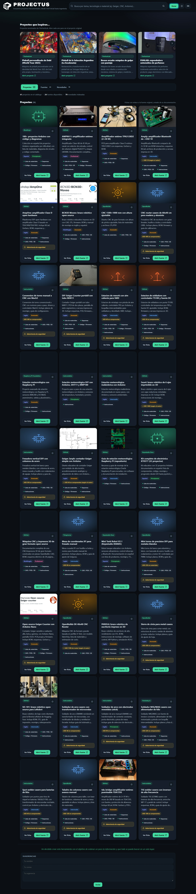

# PROJECTUS - Buscador de proyectos documentados

PROJECTUS es una herramienta web estática para descubrir proyectos técnicos documentados: electrónica, Arduino, Raspberry Pi, CNC, impresión 3D, robótica, audio, instrumentación y proyectos maker.

La aplicación se ejecuta en el navegador sin backend. Los datos se cargan desde archivos JSON incluidos en el repositorio.

## Características

- Búsqueda por texto en título, resumen, fuente, etiquetas y categoría.
- Catálogo de proyectos con ficha, enlace a la fuente original y estado de documentación.
- Carousel de proyectos destacados de TheHackLab.
- Directorio de fuentes con búsqueda directa en cada sitio.
- Búsquedas sugeridas para localizar documentación, BOM y planos.
- Novedades indexadas desde fuentes con API o RSS.
- Interfaz en español e inglés.
- Tema claro/oscuro.
- Diseño responsive para desktop y mobile.

## Archivos principales

- `index.html`: estructura de la interfaz.
- `styles.css`: estilos y diseño responsive.
- `app.js`: lógica de búsqueda, filtros, renderizado y eventos.
- `proyectos.json`: catálogo de proyectos.
- `directorio_proyectos.json`: fuentes y búsquedas sugeridas.
- `indice.json`: novedades indexadas.
- `data.js`: copia embebida de los datos para uso sin servidor.
- `indice.js`: copia embebida del índice de novedades.

## Datos

El catálogo incluye proyectos con metadatos como categoría, idioma, dificultad, presupuesto estimado, disponibilidad de materiales, esquemas, archivos CAD, código fuente e instrucciones de construcción.

Los enlaces siempre apuntan a la fuente original para consultar la documentación completa.

## Notas

- La herramienta no extrae contenido automáticamente: enlaza a las fuentes originales.
- Los favoritos se guardan en `localStorage`.
- Para actualizar el índice de novedades, ejecutar los scripts disponibles en `scripts/` si están presentes.
